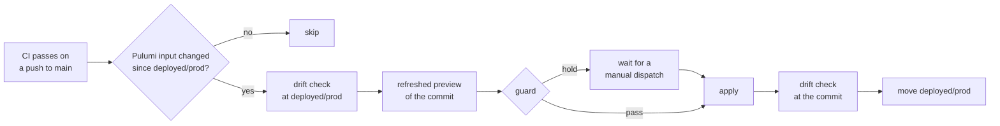

# Infrastructure as code

One Pulumi program, in `infra/`, declares every cloud resource and every workload in the k3s
cluster, and one stack, `prod`, holds the live state. Pulumi runs on Bun, and every run reads its
inputs from 1Password through `op run`, so the program sees each secret only for the length of a
run. A preview changes nothing. The apply job applies each merged change on its own, unless its plan
guard holds the change for a person, and the guards at the top of the program stop a run whose
inputs would plan a mass delete. [The host](./host/host.md) covers the NixOS host, which Pulumi does
not drive.

## What the program owns

The program's root module reads the inputs once and composes the estate from groups, each a folder
with one entry module: the inputs, the edge (the VM, its cloud firewall, the zone and the backups
bucket), the tailnet, public ingress, the cluster's workloads, and observability. The root module
builds the cluster's Kubernetes provider and passes it to each group that runs a workload, so no
group creates another group's resources. Each provider manages its own part of the estate:

| Provider                | Manages                                                                    |
| ----------------------- | -------------------------------------------------------------------------- |
| Onidel, this repo's own | the VM and the cloud firewall outside it                                   |
| Cloudflare              | the tunnel and its routes, the zone's HTTPS redirect, the Worker, R2       |
| Tailscale               | the whole tailnet policy file, and the auth keys that tagged nodes join by |
| Kubernetes              | every workload in k3s, through the cluster's API on the tailnet            |

One Pulumi preview covers all four, so a change to a route, a grant and the workload behind them
reviews as one diff.

No Pulumi or Terraform provider for Onidel exists, so the repo builds a partial one in Go with
pulumi-go-provider's `infer` package and generates its TypeScript SDK
([the provider README](../../provider/README.md)). Onidel's API has no calls for block volumes, so
the VM's second disk was added by hand and the provider never sees it. The VM itself was made by
hand and imported, and almost every input replaces it, so the program protects it and keeps it on a
delete: a typo in its inputs fails the preview instead of destroying the host.

The program writes one value back outside Pulumi. imp's reusable tailnet key, which imp's dev
instances join by, is minted by Pulumi and copied into its 1Password item on each new key, so the
item always holds the live key.

## What the program never owns

- **The host's configuration.** The NixOS flake owns it, and a host switch applies it
  ([the host](./host/host.md)).
- **impd's DNS records.** impd writes the records for its own hostnames and its ACME challenges at
  run time, so a Pulumi declaration of them would fight impd on every apply
  ([imp on the host](./host/imp.md#dns-and-certificates)).
- **The owner's PC.** The gateway dials the PC's daemon over the tailnet, and the policy names the
  PC by address, but nothing here configures it.

## State and drift

Pulumi keeps its state in an R2 bucket and encrypts each secret in it with a passphrase from
1Password. The state therefore holds the secrets Pulumi generated, such as Grafana's admin password,
and only the passphrase opens them; replacing the passphrase would strand every secret in the state.

Drift is any difference between the live resources and the code. The drift check is a preview that
refreshes from the live APIs first and fails on any change, so it passes only against the revision
that was last applied. A clean `main` passes only when every merged change is applied, because a
merged change nobody has applied yet reads as drift too. An apply is therefore bracketed: a drift
check from the last applied revision proves the baseline, a refreshed preview from the new `main`
shows only the reviewed changes, and a second drift check proves the apply landed. The apply job
runs that bracket on every apply. No scheduled check runs between applies, because Onidel offers
only full-account API keys and a scheduled job would hold one around the clock.

Some resources are declared to avoid drift on their own. The host's auth keys are single-use, so
after the host joins they read as used, and the program never mints them again until a reinstall
replaces them on purpose. A Service that the host dials by its cluster address pins that address and
ignores later changes to it, so a refresh never reads it as drift
([1Password Connect](./workloads/onepassword-connect.md)).

## The apply job

A merged change to a Pulumi input reaches production through a GitHub Actions workflow, because the
state lives in R2 and Pulumi's own hosted deployments apply only stacks in Pulumi Cloud. The job
runs on a GitHub-hosted runner, so it reaches the cluster over the tailnet as its own ephemeral
node.

The tag `deployed/prod` marks the last revision the job applied, and it moves only after an apply
and its second drift check pass. It is therefore the baseline for both the path filter and the first
drift check. The job compares the tag with the commit, not the commit with its parent, so a run that
GitHub dropped from the queue loses nothing: the next run applies every change since the tag. A
commit that is already at or behind the tag skips, and a tag outside the commit's history fails the
run, because only a person can say which revision is live. A person sets the tag once, at the last
revision applied by hand.

GitHub environments here offer branch policies and secrets but no required reviewers, so a guard on
the plan takes the reviewer's place. It reads the refreshed preview and holds the apply on any of
these:

- a delete or a replace, or any step that is not a create, an update, a refresh or a read, so an op
  Pulumi adds later holds too;
- any change to the tailnet policy, the VM or the cloud firewall, because each can cut the host off
  or open it, and the owner reviews a policy diff before it applies;
- a failed drift check from the deployed revision, because the plan then holds changes nobody
  reviewed.

A held run fails and alerts on Discord. A manual dispatch of the workflow on `main` applies whatever
its own preview plans, so the person who dispatches it has read the held plan first. The dispatch
applies only once CI has passed on main's tip, because a dispatch skips the trigger that waits for
CI. Until someone applies or reverts the held change, every later push to `main` runs the job and
holds again, because the tag still sits behind the change. A failed apply or a failed second drift
check leaves the tag where it was, so the next run's first drift check fails and holds until a
person repairs the stack.

The apply plans again from a fresh refresh, so the guard covers the preview and not the apply
itself. A change made outside Pulumi in the minutes between the two reaches the apply unguarded.
Pulumi's update plans would close that gap, but they are experimental, and a plan they reject stops
the apply partway, which leaves the stack half changed.

One apply runs at a time, and GitHub never cancels one in progress, because a cancelled apply leaves
the stack half changed. The queue holds only the apply step, which a run reaches after its decision,
so a failed CI run, a pull request's run and a commit with nothing to apply never join it. The queue
keeps every apply that waits, up to GitHub's cap on a concurrency group, so no apply takes the place
of another. GitHub starts the waiting applies first in, first out, but does not guarantee that
order, and a run starts when CI on its commit passes, so an older commit's apply can start after a
newer commit's. A waiting apply reads the tag again once its turn comes, so the older apply finds
its commit already deployed and skips, and the tag moves only forward along `main` in any order. The
decisions run one at a time in a queue of their own, which keeps every waiting decision in the same
way, so the applies mostly join their queue in the order the runs started.

The decision counts every commit since the tag that touches a Pulumi input, not the difference
between the two trees. A commit that reverts an input change while that change applies therefore
still gets its own apply, and a decision of nothing to apply stays right after the tag moves
forward.

The job prints only each held step's op and resource name, never a resource's state, and its Pulumi
runs suppress the stack outputs, because the repo and its logs are public.

The job reads its secrets from its own 1Password vault, `cloud-deploy`, through a service account
whose token is the `prod` environment's one secret. The vault holds a copy of each item `.env`
references and nothing else, so a leaked token reaches no item the program does not already read.
The job points `.env` at that vault before it resolves anything. Its tailnet node joins through a
federated identity, with no stored key, as `tag:cloud-deploy`, whose one grant reaches the k3s API
on the host ([the tailnet](./network/tailnet.md)).

Two writes outside Pulumi stay with a person. The program copies each new `tag:imp` key into the
`cloud` vault, which the job's account cannot write, but a new key replaces the old one and the
guard holds every replace. A NixOS switch and an agent-image rollout run by hand
([workflows](../runbooks/workflows.md)).

## Guards

A missing input can read as "this subsystem is gone", and Pulumi would then plan to delete it. The
program therefore checks every input that decides whether a subsystem exists, and throws instead.
The program's entry module reads the stack config and the environment once and hands both to the
inputs group, which runs every check before any resource registers. A lint rule bans a direct read
anywhere else, so no check can move behind a resource. An unset variable and one that holds only
whitespace fail alike:

- **The cluster mode.** The stack config states whether the cluster is managed. An unset mode fails
  the run, and a managed cluster with no kubeconfig fails it too, because otherwise a run outside
  `op run` would plan to delete every cluster resource.
- **Connect's credentials.** A managed cluster needs the Connect server's credentials, as non-empty
  JSON, for the same reason, and the error never holds the value.
- **The gateway's inputs.** With the gateway configured, one schema checks its stack config: both
  images pinned by tag and digest, the gateway's image a real release rather than the test stand-in,
  the public URL an https origin, and each daemon's name, address and ID, with the default daemon
  among them. Each daemon also needs its bearer token. The preview fails and names the input, so a
  bad value never reaches a pod that crash-loops ([the atc gateway](./workloads/atc-gateway.md)).
- **The gateway's backup.** Its backup inputs are all set or all unset. A partial set fails the run,
  because a silent drop of the backup job would read as success.
- **The alert webhook.** Discord alerts turned on with no webhook fail the run, so the flag never
  deploys an Alertmanager that sends nothing.

The guards fail closed, so the one setting that removes a subsystem on purpose is an explicit one: a
cluster mode of `none` plans the delete of every cluster resource, and nothing in the program sets
it.
