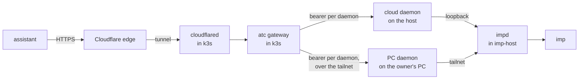
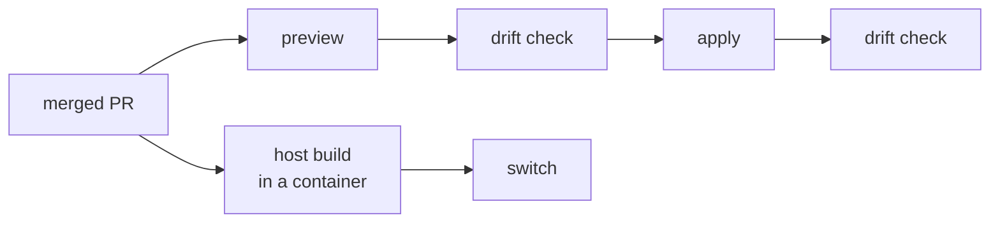
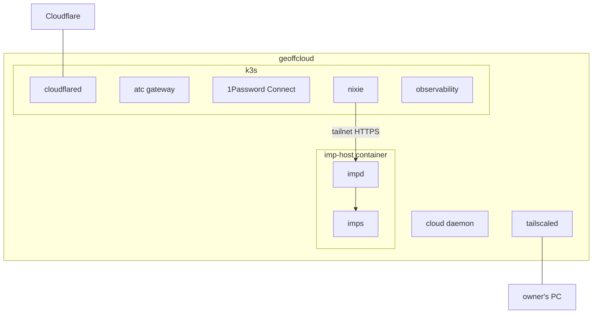

# Architecture overview

geoff.cloud is the owner's private cloud: one Onidel VM, `geoffcloud`, that runs NixOS, a
single-node k3s cluster and imp, and that joins the owner's tailnet as its private network. Every
cloud resource is declared in one Pulumi program, and the host itself is one NixOS flake, so this
repo holds the whole estate and a change to it is a reviewed PR before it is a live change. The
first workload is an agent platform: [atc](https://github.com/zgeoff/atc) manages agent sessions,
and [imp](https://github.com/zgeoff/impz) runs each one in a Firecracker microVM. The one public
entry point is atc's MCP endpoint, which an assistant such as ChatGPT reaches through a Cloudflare
tunnel. Everything else stays on the host or on the tailnet.

## The path of a public call

An assistant's MCP call crosses the Cloudflare edge, an outbound tunnel, the atc gateway in k3s and
an atc daemon before it reaches an agent session in an imp.

The host opens no inbound port for the call. cloudflared holds the tunnel open from inside the
cluster, and the edge sends the gateway's hostname down it while every other hostname gets a 404
([public ingress](./network/public-ingress.md)). The gateway is atc's MCP origin and its OAuth
issuer, so it signs clients in and then dials the daemon a call names, or the default daemon when
the call names none. A daemon owns its sessions and runs each one on an execution target. A target
of the `imp` kind asks impd for a fresh imp per session, so both daemons can put sessions on this
host's imps: the cloud daemon reaches impd on the host's loopback with a token confined to its own
imps, and the PC daemon reaches impd's tailnet node from the owner's PC
([the atc gateway](./workloads/atc-gateway.md)). The PC daemon's imps run the agent image this repo
builds ([the agent image](./workloads/agent-image.md)).

## The path of a change

A change reaches the live estate along one of two paths, and both start from a merged PR on `main`.

Pulumi owns the cloud resources and the cluster's workloads. A preview shows a change before it
applies, and a drift check, a refreshed preview that fails on any difference, proves before and
after an apply that the live state matches the code
([infrastructure as code](./infrastructure-as-code.md)). The host is outside Pulumi: a script builds
the flake from the commit, copies that exact system to the host and activates it, so a failed build
never touches the host ([the host](./host/host.md)). The apply job runs the Pulumi path on its own
once CI passes, unless its guard holds the plan for a person. The owner or an agent the owner
approved runs each host switch.

## Topology

The VM holds three kinds of workload, and one placement rule decides where each runs. Host-level
work, which needs the kernel, the disks or the host's own network, runs on NixOS or beside it on the
host. A containerised app runs on k3s, because a Helm chart or a manifest describes it there and
Pulumi deploys it with the rest of the estate.

- **k3s** runs every workload that a Helm chart or a manifest describes: cloudflared, the gateway,
  1Password Connect, nixie and the monitoring stack. It is chosen for that tooling, since a single
  node needs no scheduler.
- **imp** runs as imp ships it, in one container on the host's Docker, outside k3s, because impd
  schedules its own microVMs and needs KVM and a ZFS pool on the host
  ([imp on the host](./host/imp.md)).
- **The cloud daemon** is a NixOS service on the host, beside imp-host, so it reaches impd on the
  host's loopback.
- **The preview service** is a NixOS service on the host for the same reason: it runs each pull
  request's preview in an imp, behind a tailnet link ([previews](./workloads/preview.md)).

The host's tailnet node carries every pod's tailnet traffic, so a pod reaches the tailnet with the
host's identity. The tailnet policy therefore grants the host only the ports its workloads dial
([the tailnet](./network/tailnet.md)). Four firewall layers keep the public internet off everything
but Tailscale's own port ([firewalls](./network/firewalls.md)).

## Data

The estate keeps state in five places, and each has its own backup or none:

- **Pulumi state** sits in a Cloudflare R2 bucket, encrypted with a passphrase, and holds every
  secret Pulumi generated, such as Grafana's admin password
  ([infrastructure as code](./infrastructure-as-code.md)).
- **impd's state** sits on its own encrypted ZFS dataset on the VM's second disk: its SQLite
  database, its tokens and its secrets. impd backs the imps up to R2 itself, and an operator copies
  the database before each imp upgrade ([imp on the host](./host/imp.md)).
- **The gateway's state**, two SQLite files with every OAuth client and grant, sits on a cluster
  volume that outlives its claim, and a nightly job backs it up to R2. nixie's databases sit on a
  volume of the same kind, with their own nightly backup
  ([the atc gateway](./workloads/atc-gateway.md#state-and-backup)).
- **Metrics and logs** sit on cluster volumes with no backup, because losing them loses history,
  never service ([observability](./workloads/observability.md)).
- **Deployment inputs** live in the owner's 1Password vault `cloud`, which the repo names only by
  reference ([secrets](./secrets.md)).

The data sits on the second disk and its key on the root disk, so neither disk alone exposes the
data. ZFS encrypts two dataset trees there: impd's dataset, and `tank/cloud`, which holds k3s's data
directory, the host's secret files and the copies of impd's database. k3s's data directory holds the
cluster's datastore and every cluster volume. Every Onidel snapshot copies the root disk, which
keeps only the key, the host's tailnet identity, its SSH host keys and the atc daemon's state in
plain form. Onidel never snapshots the second disk, so its data relies on each system's own backup
([protection at rest](./secrets.md#protection-at-rest)).

## Cross-cutting

- **Public by exception.** A new service stays on the host or on the tailnet. A public route needs
  its own reason in its PR and an auth layer named in the exposure registry, and the tunnel is the
  only way in ([public ingress](./network/public-ingress.md)).
- **Secrets never in the repo.** The repo is public. Every secret reaches its user through
  1Password, Pulumi's encrypted state or a root-only file on the host, and never through a command
  line, because the host's journal records each SSH command line ([secrets](./secrets.md)).
- **A missing metric alerts.** Every rule built on a probe fires when the probe's metric is absent
  as well as when it is bad, so a probe that stops reporting never reads as healthy, and a check
  from Cloudflare's edge covers the case where the host itself is down
  ([observability](./workloads/observability.md)).
- **Pod Security at baseline.** Every namespace in k3s except three exempt ones carries Pod
  Security's `baseline` level in its enforce, warn and audit modes, so the API server refuses a pod
  that asks for the host's network, a hostPath or a host port. A NetworkPolicy never applies to a
  pod on the host's network, which is why the level matters. The exempt namespaces each hold one
  kind of pod that needs the host: observability holds node-exporter, which reads the host's
  network, nixie-ingress holds nixie's Traefik, which holds a host port, and kube-system holds the
  local-path provisioner's helper pods, which mount a hostPath for each new volume. The program's
  namespace registry lists every namespace with its level, and Pulumi patches the labels onto the
  namespaces that k3s creates.
- **Guards fail the preview.** An input that would make Pulumi plan to delete a whole subsystem
  fails the run instead of planning the delete
  ([infrastructure as code](./infrastructure-as-code.md#guards)).
