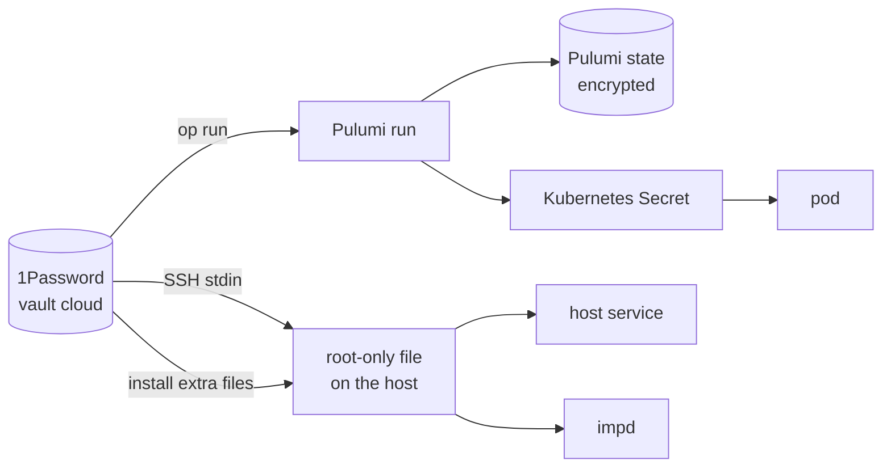

# Secrets

The repo is public, so it holds no secret, only references to them. Every secret the estate runs on
starts in the owner's 1Password vault `cloud`, or is generated by the system that uses it, and
reaches its user along one of five paths. Each path keeps the value out of the repo, out of a log
and off a command line, because the host's journal records the full command line of every SSH
session and ships it to Loki. gitleaks scans each commit before it lands and the whole history in
CI.

## The five paths

- **Into a Pulumi run.** The committed `.env` holds only `op://` references, and every Pulumi
  command runs inside `op run`, which resolves them into the run's environment. The apply job reads
  the same items from copies in its own vault, `cloud-deploy`, which holds nothing else
  ([infrastructure as code](./infrastructure-as-code.md#the-apply-job)). The program marks each
  value secret, so Pulumi encrypts it in the state and redacts it in output.
- **Into a pod.** A workload's secret becomes a Kubernetes Secret that the program declares from the
  run's value, and the pod reads it as a file or an environment variable. A gateway token Secret has
  no fixed name, so a change replaces it and rolls the gateway, which reads its tokens only at
  start.
- **Onto the host.** A host secret sits in a root-only file under `/var/lib`, on the encrypted
  dataset that [protection at rest](#protection-at-rest) describes. The reinstall places the first
  set with the install's extra files, and a script in `scripts/` installs or rotates the rest by
  reading the value with `op read` and sending it on SSH's standard input, never in the remote
  command. Each script writes its file atomically, so a failed run leaves the old value whole.
- **Into nixie's process.** nixie's secrets live in a sops file in the repo, encrypted to the host's
  age key and a recovery key. Pulumi gives the pod the encrypted file and the host's age identity as
  a Secret, and nixie decrypts the file in its own process at start
  ([nixie](./workloads/nixie.md#secrets)).
- **Into a service.** A host service never reads a secret file itself. The atc daemon takes its two
  tokens through systemd's credentials, which copy each file when the service starts, so a rotation
  reaches it only after a restart. imp's module copies its secrets to a runtime directory before
  each start of imp-host and mounts them read-only.

## Protection at rest

The host keeps its data on the second disk, `vdb`, and the data's key on the root disk, `vda`, so
neither disk alone exposes the data. Every Onidel snapshot copies `vda` whole, and Onidel never
snapshots `vdb`. A copy of either disk, alone, therefore holds the key or the data but never both.
[The tank/cloud runbook](../runbooks/tank-cloud.md) creates the datasets and restores their key.

ZFS on the pool `tank` encrypts the data under two encryption roots, both keyed by the one key:

| Data                                          | Dataset                     | Encryption root |
| --------------------------------------------- | --------------------------- | --------------- |
| everything impd keeps on the pool             | `tank/imp`                  | `tank/imp`      |
| k3s's data directory and its config directory | `tank/cloud/rancher`        | `tank/cloud`    |
| the host services' secret files               | `tank/cloud/host-secrets`   | `tank/cloud`    |
| the copies of impd's database                 | `tank/cloud/imp-db-backups` | `tank/cloud`    |

k3s's data directory holds the cluster's datastore and every cluster volume, so every Kubernetes
Secret and the gateway's and nixie's databases sit on the zvol too. `tank/cloud/rancher` is a zvol
that holds ext4. Each service reads its usual path, because the host mounts the dataset, or binds a
directory of it, at that path.

### What stays plain on the root disk

Four things stay on `vda` in plain form, each for a reason:

- **The host's Tailscale node state**, because access to the host must never depend on the pool. A
  host whose pool fails to unlock still joins the tailnet and answers SSH.
- **The ZFS key**, because the host unlocks the pool at boot with no one present.
- **The OpenSSH host keys**, which identify the host to an SSH client.
- **The atc daemon's state directory**, which holds neither of the daemon's tokens.

### The key and the unlock

The key is one hex key in a root-only file on `vda`, escrowed in the 1Password item `zfs-tank-key`.
A reinstall places it with `op read --no-newline` and checks its length, so a wrong item fails
before the install. At boot the host loads the key and mounts the `tank/cloud` datasets, which NixOS
declares as file systems with legacy mount points. k3s, imp-host and the atc daemon each require
their datasets' mounts, so none of them starts on an empty directory on `vda` when the key fails to
load. `zfs change-key` rotates the key. It rewraps the master key that encrypts the data and leaves
that master key unchanged.

### Threats

Four threats shape the layout:

1. **A leaked Onidel snapshot.** Encryption stops it, because a snapshot holds the key but no data.
   That holds while no snapshot from before the encryption survives and the root disk's free space
   holds no plain copy of the data.
2. **A leaked Onidel account.** Encryption does not stop it. The account controls the running host,
   with the key loaded. The response hardens the account and accepts the rest.
3. **A leaked restic backup.** restic encrypts each backup, and no backup's password sits on `vda`,
   so a snapshot and a backup together expose nothing.
4. **A stolen `vdb`.** It holds ciphertext without the key.

[The leak runbook](../runbooks/leak-response.md) gives the response to each leak.

### Accepted risks

The layout leaves five risks open, each accepted:

1. **No credential rotation.** Every credential that ever sat in a `vda` snapshot stays valid.
   Deleting the old snapshots and cleaning the root disk's free space are the only ways to shrink
   that exposure, and nothing can check how Onidel handles a deleted snapshot.
2. **A leaked Onidel account exposes everything**, because the account reaches the running host.
3. **The Tailscale node key, the OpenSSH host keys and the ZFS key stay plain on `vda`**, so a
   snapshot leak exposes them.
4. **`zfs change-key` leaves the master key unchanged**, so someone with an old key and a copy of
   `vdb` from before the change recovers the master key, which still decrypts a later copy.
5. **Losing the pool loses impd's named tokens and grants and the copies of impd's database**,
   because they live only on the pool. A rebuild mints the tokens again.

## Secrets 1Password cannot restore

Three kinds of secret exist only where their system keeps them, and a rebuild that loses that place
loses them:

- **Pulumi's generated secrets**, such as Grafana's admin password, live only in the encrypted state
  in R2.
- **impd's own secrets** live on its dataset: its root token, the broker's certificate authority,
  its TLS files and the values of the secrets it injects. impd's database holds its named tokens and
  the names of its secrets. The token that lets a granted imp read 1Password lives only there, as
  one of impd's secrets ([1Password Connect](./workloads/onepassword-connect.md)).
- **k3s's own credentials**, its certificate authorities and its node token, live only in k3s's data
  directory. A rebuilt cluster makes new ones, so the kubeconfig in 1Password changes with it
  ([the restore runbook](../runbooks/restore-geoff-cloud.md#5-rebuild-the-cluster)). Every
  Kubernetes Secret that Pulumi declares comes from 1Password or Pulumi's state, so Pulumi makes it
  again.

## Items outside `.env`

The program reads the items `.env` references. Four more items in the vault serve other readers:

| Item                    | Read by                                                                  |
| ----------------------- | ------------------------------------------------------------------------ |
| `imp-tailscale-authkey` | the `tag:imp` key; Pulumi writes each new one into it                    |
| `imp-restic`            | imp's backup password, placed on the host at reinstall                   |
| `r2-backups`            | imp's backup repository and its R2 keys, placed on the host at reinstall |
| `imp-dns-cloudflare`    | imp's DNS token and ACME email, which the DNS token script installs      |

## The Onidel VM object

Onidel's API returns the VM's root password in the VM object. The provider drops the password when
it decodes a response, so it never enters the state, and no script prints a whole VM object.
