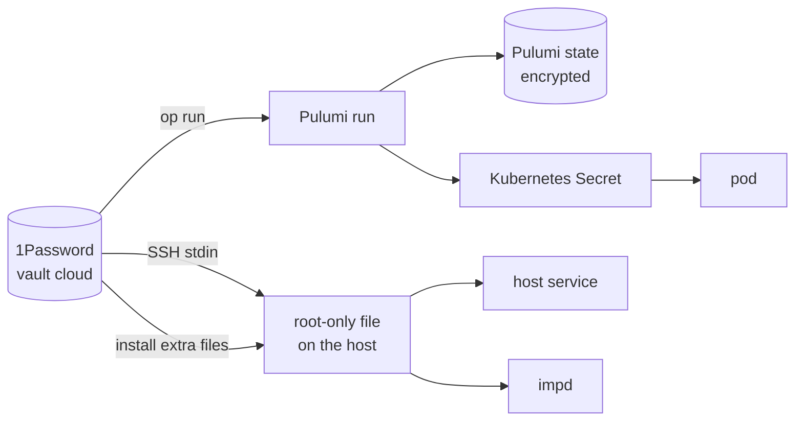

# Secrets

The repo is public, so it holds no secret, only references to them. Every secret the estate runs on
starts in the owner's 1Password vault `cloud`, or is generated by the system that uses it, and
reaches its user along one of four paths. Each path keeps the value out of the repo, out of a log
and off a command line, because the host's journal records the full command line of every SSH
session and ships it to Loki. gitleaks scans each commit before it lands and the whole history in
CI.

## The four paths

- **Into a Pulumi run.** The committed `.env` holds only `op://` references, and every Pulumi
  command runs inside `op run`, which resolves them into the run's environment. The program marks
  each value secret, so Pulumi encrypts it in the state and redacts it in output.
- **Into a pod.** A workload's secret becomes a Kubernetes Secret that the program declares from the
  run's value, and the pod reads it as a file or an environment variable. A gateway token Secret has
  no fixed name, so a change replaces it and rolls the gateway, which reads its tokens only at
  start.
- **Onto the host.** A host secret sits in a root-only file under `/var/lib`. The reinstall places
  the first set with the install's extra files, and a script in `scripts/` installs or rotates the
  rest by reading the value with `op read` and sending it on SSH's standard input, never in the
  remote command. Each script writes its file atomically, so a failed run leaves the old value
  whole.
- **Into a service.** A host service never reads a secret file itself. The atc daemon takes its two
  tokens through systemd's credentials, which copy each file when the service starts, so a rotation
  reaches it only after a restart. imp's module copies its secrets to a runtime directory before
  each start of imp-host and mounts them read-only.

## Secrets 1Password cannot restore

Three kinds of secret exist only where their system keeps them, and a rebuild that loses that place
loses them:

- **Pulumi's generated secrets**, such as Grafana's admin password, live only in the encrypted state
  in R2.
- **impd's own secrets** live on its dataset: its root token, the broker's certificate authority,
  its TLS files and the values of the secrets it injects. impd's database holds its named tokens and
  the names of its secrets. The token that lets a granted imp read 1Password lives only there, as
  one of impd's secrets ([1Password Connect](./workloads/onepassword-connect.md)).
- **The cluster's datastore** holds every Kubernetes Secret in plain form on the root disk, and
  therefore in each Onidel snapshot of it.

## Items outside `.env`

The program reads the items `.env` references. Four more items in the vault serve other readers:

| Item                    | Read by                                                                  |
| ----------------------- | ------------------------------------------------------------------------ |
| `imp-tailscale-authkey` | imp's dev instances; Pulumi writes each new `tag:imp` key into it        |
| `imp-restic`            | imp's backup password, placed on the host at reinstall                   |
| `r2-backups`            | imp's backup repository and its R2 keys, placed on the host at reinstall |
| `imp-dns-cloudflare`    | imp's DNS token and ACME email, which the DNS token script installs      |

## The Onidel VM object

Onidel's API returns the VM's root password in the VM object. The provider drops the password when
it decodes a response, so it never enters the state, and no script prints a whole VM object.
