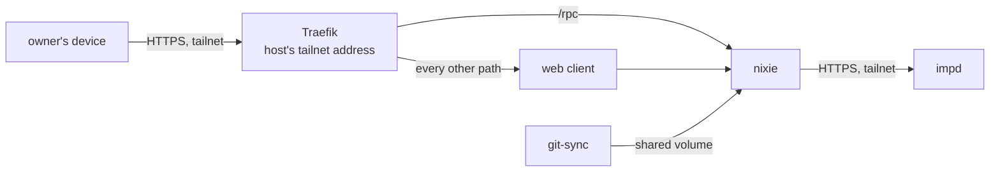

# nixie

nixie is the owner's assistant: a server that keeps its state in one SQLite database, a web client
in front of it, and an imp for every model loop it runs. It runs in k3s from nixie's released
images, and it answers on the tailnet only, at one public name that points at the host's tailnet
address. nixie reaches impd over the tailnet with a token limited to its own imps, so the host owner
adds nixie's images and its model credential to impd by hand before nixie starts.
[The tailnet](../network/tailnet.md) covers the grants on the route in and out, and
[the nixie runbook](../../runbooks/nixie.md) gives the steps for a deploy, an upgrade and a
rotation.

## The pods

nixie's design in its own repo sets the shape, and this repo keeps its own version of it. nixie runs
as one replica of a StatefulSet, because SQLite takes one writer, and a rollout stops the old pod
before it starts the new one. The data volume is a claim of the retaining storage class that the atc
gateway's volume uses, so deleting the claim keeps `nixie.db` and the key store beside it. The
volume sits on the root disk, so each Onidel snapshot of the disk holds the database in plain form.

The web client is a Deployment of its own, because it holds no state, no secret and no database. It
calls nixie's API at its cluster address, and the browser calls `/rpc` on the web client's own
origin. Pulumi creates the web client after nixie, so a first deploy starts the API before the
client that calls it.

Both containers run as their images' users on a read-only root, with writable volumes only for
nixie's data and each container's temporary directory. nixie's health endpoint listens only once
migrations and the integrity check finish, so the pod's startup probe waits on liveness before the
readiness probe takes over. Readiness lists each part that nixie's slice 1 builds: the database, the
definitions seed, impd, the conversation imp and the disk.

## Configuration and definitions

nixie reads its settings from `deploy/nixie/config.yaml`, which Pulumi turns into a ConfigMap
mounted at the path nixie reads. The ConfigMap and both Secrets have no fixed name, so a change to
any of them replaces it, and the StatefulSet rolls onto the new name. nixie reads each file once at
start, so a roll is how a change reaches it.

nixie reads its definitions, the persona and the rules in the private repo
`zgeoff/nixie-definitions`, from a directory. A git-sync sidecar clones that repo over SSH into a
volume the two containers share, and pulls it again every minute. git-sync swaps a `current` link to
each new checkout in one rename, and nixie reads through that link, so a seed never sees half a
checkout. On a first start the seed retries until the first clone arrives. The pod's file-system
group is a supplementary group of both containers, which is what lets git-sync read its key and
nixie read git-sync's checkout.

## Secrets

nixie decrypts its own secrets file in its own process at start and keeps the plaintext in memory.
The file is `deploy/nixie/secrets.sops.yaml`, encrypted with sops to two age recipients: the host
key, which the pod holds, and the recovery key, which stays in 1Password and off the host. The repo
holds only the public halves, in the sops config beside the file. The file holds the deployment key
that wraps every record key, the model credential, and nixie's impd token.

Pulumi puts the encrypted file and the host's age identity into one Secret, and only the nixie
container mounts it. git-sync's deploy key and GitHub's pinned host key sit in a second Secret that
only git-sync mounts, so neither container holds the other's credential. The deploy key reads the
definitions repo and nothing else. git-sync reaches GitHub's SSH on port 443, because the host
blocks outbound port 22.

## Reaching impd

nixie calls impd's API at `imps.geoff.cloud` over HTTPS. A pod has no tailnet identity of its own,
so the call leaves through the host's node as `tag:cloud`, and the grant to impd's node on HTTPS
that the cluster's health probe uses carries it too. impd delivers each tool call from an imp back
over nixie's own connection, so the pod opens no inbound port for its tools.

nixie's impd token can manage only imps whose names carry nixie's prefix, and grant only nixie's
model secret to them. impd refuses an image add and a secret add to such a token, because both are
host-wide, and nixie's start makes both calls unless impd already holds the image or the secret. The
host owner therefore adds nixie's sandbox images and its model secret as root before a deploy that
changes either, under the names nixie derives: each image's kind and the head of its digest, and the
model profile with a digest of its credential. A credential rotation or a release with new sandbox
images repeats that step.

## The route in

nixie's public name, `nixie.geoff.cloud`, is a DNS-only record at the host's tailnet address, so it
resolves anywhere and answers on the tailnet only, the pattern impd's names follow. Traefik serves
the route as nixie's ingress controller. It holds the host's HTTPS port through a hostPort bound to
the tailnet address alone, so no other interface answers. It watches nixie's namespace only and
serves no dashboard. The NixOS firewall trusts the tailnet interface, and the tailnet policy lets
every member's device reach the host on HTTPS ([firewalls](../network/firewalls.md)).

The Ingress sends `/rpc` to nixie and every other path to the web client. Its certificate comes from
Let's Encrypt through a DNS-01 challenge that the Pulumi run answers with Pulumi's own Cloudflare
token, so no DNS token enters the cluster. The run stores the certificate as a TLS Secret, and an
apply near expiry renews it. Nothing renews it between applies, so the owner applies at least once
in each renewal window ([the runbook](../../runbooks/nixie.md#renew-the-certificate)).
