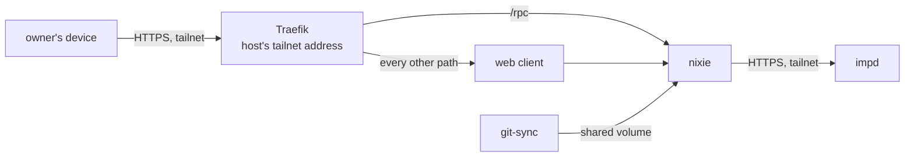

# nixie

nixie is the owner's assistant: a server that keeps its state in one SQLite database, a web client
in front of it, and an imp for every model loop it runs. It runs in k3s from nixie's released
images, and it answers on the tailnet only, at one public name that points at the host's tailnet
address. nixie reaches impd over the tailnet with a token limited to its own imps, so the host owner
adds nixie's model credential to impd by hand before nixie starts. The prod apply adds each
release's sandbox images to impd before nixie rolls, so the new pod finds them in place.
[The tailnet](../network/tailnet.md) covers the grants on the route in and out, and
[the nixie runbook](../../runbooks/nixie.md) gives the steps for a deploy, an upgrade and a
rotation.

## The pods

nixie's design in its own repo sets the shape, and this repo keeps its own version of it. nixie runs
as one replica of a StatefulSet, because SQLite takes one writer, and a rollout stops the old pod
before it starts the new one. The StatefulSet starts and replaces its pod without waiting for it to
turn ready, so an apply that fixes an unready nixie rolls it out. The data volume is a claim of the
retaining storage class that the atc gateway's volume uses, so deleting the claim keeps `nixie.db`
and the key store beside it. A nightly CronJob runs nixie's own backup command, which copies both
databases, and uploads the copy with restic to nixie's own R2 bucket, encrypted with a password that
only 1Password and the backup's Secret hold. Only nixie's backup and restore commands open nixie's
databases, so nixie may change its files between releases without breaking the backup. The CronJob
runs as nixie's user, so a restore leaves files nixie can open, and the record keys stay useless
without the deployment key in the secrets file. [nixie's backup](../../runbooks/nixie-backup.md)
gives the steps. The volume sits in k3s's data directory on the encrypted zvol on the second disk,
so no Onidel snapshot holds the databases ([protection at rest](../secrets.md#protection-at-rest)).

The web client is a Deployment of its own, because it holds no state, no secret and no database. It
calls nixie's API at its cluster address, and the browser calls `/rpc` on the web client's own
origin. Pulumi creates the web client after nixie, so a first deploy starts the API before the
client that calls it.

Pulumi waits for the StatefulSet and the web client's Deployment to report ready pods, and never for
their Services. The StatefulSet names the API's Service, so Pulumi updates the StatefulSet after
that Service, and a Service that waited for ready pods would hold back the rollout that brings them.

Both containers run as their images' users on a read-only root, with writable volumes only for
nixie's data and each container's temporary directory. nixie's health endpoint listens only once
migrations and the integrity check finish, so the pod's startup probe waits on liveness before the
readiness probe takes over. The readiness probe takes nixie out of its Service only when the
database or the definitions seed fails, because nixie cannot serve without them. impd, the
conversation imp and the disk are dependency parts: one that fails or answers slowly makes nixie
answer 200 with the status degraded, because nixie is the only endpoint behind its Service and still
serves its API. The NixieDegraded alert watches that status
([alert rules](observability.md#alert-rules)).

## Configuration and definitions

nixie reads its settings from `deploy/nixie/config.yaml`, which Pulumi turns into a ConfigMap
mounted at the path nixie reads. Pulumi adds the `imp` section, impd's URL and the host's addresses,
from `packages/topology`, so the file holds no copy of them. The ConfigMap and both Secrets have no
fixed name, so a change to any of them replaces it, and the StatefulSet rolls onto the new name.
nixie reads each file once at start, so a roll is how a change reaches it.

nixie reads its definitions, the persona and the rules in the private repo
`zgeoff/nixie-definitions`, from a directory. A git-sync sidecar clones that repo's `live` branch
over SSH into a volume the two containers share, and pulls it again every minute. A merge to the
repo's `main` branch changes nothing in production: a commit reaches nixie only when someone
promotes it to `live`, as
[the definitions repo's readme](https://github.com/zgeoff/nixie-definitions#going-live) describes.
git-sync swaps a `current` link to each new checkout in one rename, and nixie reads through that
link, so a seed never sees half a checkout. On a first start the seed retries until the first clone
arrives. The pod's file-system group is a supplementary group of both containers, which is what lets
git-sync read its key and nixie read git-sync's checkout.

nixie never writes to that checkout. When nixie writes a skill, it opens a pull request in
`zgeoff/nixie-definitions` with a token from its secrets file, and git-sync brings the skill back
once someone promotes the merged commit to `live`.

nixie, not this repo, owns the definitions format:
[nixie's definitions doc](https://github.com/zgeoff/nixie/blob/main/docs/architecture/core/definitions.md#the-definitions-format)
defines it, and each nixie release publishes the JSON Schema of the definitions manifest.

## Secrets

nixie decrypts its own secrets file in its own process at start and keeps the plaintext in memory.
The file is `deploy/nixie/secrets.sops.yaml`, encrypted with sops to two age recipients: the host
key, which the pod holds, and the recovery key, which stays in 1Password and off the host. The repo
holds only the public halves, in the sops config beside the file. The file holds the deployment key
that wraps every record key, the model credential, nixie's impd token, the token nixie opens a pull
request in the definitions repo with for each skill it writes, and the owner's name under
`settings`, which the configuration names as `deployment:owner_name` so the name stays out of this
public repo.

Pulumi puts the encrypted file and the host's age identity into one Secret, and only the nixie
container mounts it. git-sync's deploy key and GitHub's pinned host key sit in a second Secret that
only git-sync mounts, so neither container holds the other's credential. The deploy key reads the
definitions repo and nothing else. git-sync reaches GitHub's SSH on port 443, because the host
blocks outbound port 22.

## Reaching impd

nixie calls impd's API at `imps.geoff.cloud` over HTTPS. A pod has no tailnet identity of its own,
so the call leaves through the host's node as `tag:cloud`, on the tailnet grant to impd's node for
HTTPS that the policy names as nixie's route to impd. That grant keeps the route open when the
health probe's grant changes, and [the tailnet](../network/tailnet.md#identities) explains how the
two grants combine. impd delivers each tool call from an imp back over nixie's own connection, so
the pod opens no inbound port for its tools.

The grant belongs to the host's node, so an egress NetworkPolicy decides which pod in nixie's
namespace may use it. nixie's pod and the Job that adds its sandbox images reach impd's node, on
HTTPS only. The namespace's deny refuses the tailnet range to every other pod there, among them the
web client, the backup and restore jobs, and the restore test's nixie, which carries no label of
nixie's own. Traefik's namespace holds the same deny
([which pod uses each grant](../network/tailnet.md#which-pod-uses-each-grant)).

nixie's impd token can manage only imps whose names carry nixie's prefix, grant only nixie's model
secret to them, and add images from nixie's registry path under names with nixie's prefix. nixie's
start adds each sandbox image of its release that impd lacks, under the name it derives from the
image's kind and the head of its digest. impd refuses a secret add to such a token, because a secret
is host-wide. The host owner therefore adds the model secret as root, under the name nixie derives
from the model profile and a digest of its credential, before the first deploy and after each
credential rotation.

## Sandbox images before a roll

The prod apply adds a release's sandbox images to impd before Pulumi rolls nixie's StatefulSet.
nixie turns ready only once impd holds every image of its sandbox manifest, and a pull takes
minutes, so an add at start would leave the new pod unready after the old one stopped. Pulumi runs a
local command on the apply's machine, and the StatefulSet depends on that command:

1. The command creates a ConfigMap that holds the add script, bundled into one file, because the
   nixie image holds Bun but none of this repo's packages.
2. It starts a Job in nixie's namespace from the new nixie image, and waits for the Job to finish.
3. The Job decrypts only nixie's impd token from the secrets file, with the host's age identity that
   nixie's Secret holds, and reads the image's sandbox manifest.
4. The Job adds each image that impd lacks, with nixie's own token and under the names nixie
   derives. It refuses an image that impd holds under the same name at another digest.
5. The command prints the Job's log and removes the ConfigMap.

A failed or timed-out Job fails the command, and Pulumi then leaves the StatefulSet unchanged, so
the old nixie keeps serving. Pulumi runs the command again only when the Job it describes changes,
which a new nixie image or a new secrets file does. The Job is no Pulumi resource: Kubernetes
refuses a change to a Job's pod template, so Pulumi would replace it at each release, and the
deploy's guard holds every replace. Each run starts a fresh Job, so a retry reads impd again rather
than trust an earlier Job's result.

The Job adds without a pin, because nixie's token cannot pin an image. impd never evicts an image
used recently, and an add counts as a use, so the image stays until the new conversation imp holds
it. Delivery pins the images afterwards, as
[nixie's runbook](../../runbooks/nixie.md#pin-nixies-sandbox-images) describes. nixie's own add at
start stays as the fallback for an image that impd lost between the Job and the roll.

## The route in

nixie's public name, `nixie.geoff.cloud`, is a DNS-only record at the host's tailnet address, so it
resolves anywhere and answers on the tailnet only, the pattern impd's names follow. Traefik serves
the route as nixie's ingress controller. It holds the host's HTTPS port through a hostPort bound to
the tailnet address alone, so no other interface answers. It runs in its own namespace,
nixie-ingress, because Pod Security's `baseline` level refuses a host port, and that namespace alone
goes without the level while nixie's own pods keep it
([cross-cutting rules](../overview.md#cross-cutting)). It watches nixie's namespace only and serves
no dashboard. The NixOS firewall trusts the tailnet interface, and the tailnet policy lets every
member's device reach the host on HTTPS ([firewalls](../network/firewalls.md)).

The Ingress sends `/rpc` to nixie and every other path to the web client. Its certificate comes from
Let's Encrypt through a DNS-01 challenge that the Pulumi run answers with Pulumi's own Cloudflare
token, so no DNS token enters the cluster. The run stores the certificate as a TLS Secret, and an
apply near expiry renews it. Nothing renews it between applies, so the owner applies at least once
in each renewal window ([the runbook](../../runbooks/nixie.md#renew-the-certificate)).
