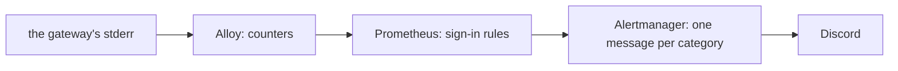

# Observability

The estate watches itself from two places. A monitoring stack in k3s collects metrics and logs from
the cluster and the host, evaluates the alert rules and sends alerts to Discord. A Cloudflare Worker
probes the public route from Cloudflare's edge, because monitoring on the host cannot report that
the host is down. Every rule that rests on one probe's metric fires when that metric is missing as
well as when it is bad, so a probe, an exporter or a timer that stops reporting raises an alert
instead of reading as healthy.

## The stack in the cluster

The stack runs in the `observability` namespace:

- **kube-prometheus-stack** runs Prometheus, Alertmanager, Grafana, node-exporter and
  kube-state-metrics, and its default rules beside this repo's own. k3s serves the metrics of its
  whole process, the API server and etcd's client included, on both the API server's and the
  kubelet's endpoints, so Prometheus keeps the control plane's series from the API server alone.
- **Loki** stores logs on a filesystem volume as a single binary. Loki retains logs by time only,
  and local-path does not enforce the volume's request, so Loki's ingestion rate limit bounds its
  disk use: the most it accepts over the time a log line stays on disk fits below that request.
- **Alloy** runs on the node and ships every pod's logs and the host's systemd journal to Loki. impd
  logs to the journal through its container's unit, so impd's logs reach Loki the same way. Alloy
  drops the gateway's OAuth approval lines before they reach Loki, because each holds the code that
  approves a client's sign-in, so it stays in the pod's own log, which only a cluster admin reads.
  Alloy keeps its read position in each log on a directory of the node, so a restart resumes where
  it stopped. Without a saved position, Alloy reads each container's whole log again. It drops the
  lines older than the hour Loki still accepts, because each line Loki rejects first counts against
  Loki's ingestion rate limit. Alloy also counts the gateway's sign-in events for Prometheus, which
  scrapes Alloy ([sign-in alerts](#sign-in-alerts)).
- **Three blackbox exporters** run the probes that need a network path: one opens a TCP connection
  to each atc daemon on the gateway's path to it, one fetches impd's health over HTTPS on the
  tailnet and requires a valid certificate and a ready answer, and one fetches nixie's readiness
  report through its Service and requires the report's conversation turns part to pass.

Grafana's admin password is a secret Pulumi generates, and Grafana's NodePort answers only on the
tailnet. Its dashboards are provisioned from code. Metrics and logs sit on cluster volumes with no
backup, because losing them loses history and never service.

## Probes of impd

impd gets two probes, and each answers a different question. A host timer asks impd's health
endpoint on the loopback and writes the answer, with the time it ran, where node-exporter's textfile
collector reads it, so impd's own state reaches Prometheus even when the tailnet is down. The HTTPS
probe asks the same endpoint the way a client does, through impd's tailnet node and its certificate,
so it fails when clients cannot reach impd even though impd itself is healthy. The loopback probe
also carries a stale alert, which fires when the timer, the textfile or node-exporter stops, so a
dead probe never reads as a healthy impd.

## Alert rules

This repo's rules live in one PrometheusRule, built in code, and each rule that rests on one probe's
metric fires on its absence too. A rule over many targets, such as the one for scrape targets, fires
only on a bad value, because a target that vanishes is no longer a target. They cover:

- impd's loopback health, and the age of its last probe;
- impd's health over HTTPS on the tailnet;
- nixie's conversation turns, which fail without changing nixie's readiness status, so only the
  advisory part of nixie's readiness report shows them;
- how long the host has run an older system or imp than the latest green build of `main`, which a
  host timer compares with GitHub every hour, and the age of its last check, because a merged change
  to the host waits for a person to switch it;
- each atc daemon's reachability, at the severity the stack config sets per daemon, so the PC
  daemon, whose host sleeps, warns while the cloud daemon pages;
- the tunnel's connections, summed over both cloudflared replicas, because the tunnel serves while
  either is connected;
- each scrape target that is down, one alert per target, replacing the chart's rule that alerts on a
  ratio;
- a container whose last restart was an out-of-memory kill, because spaced restarts never trip the
  chart's crash-loop rule;
- the atc gateway's sign-in events, in a group of their own with one alert per category
  ([sign-in alerts](#sign-in-alerts)).

## Delivery

Alertmanager sends every alert to a Discord webhook once the stack config turns Discord alerts on,
and the webhook reaches it as a mounted Secret file, so the URL never appears in Alertmanager's
config. Two alerts never send: the chart's always-firing watchdog and its inhibition helper. With
Discord alerts off, every alert goes to a receiver that sends nothing, and alerts show only in
Prometheus and Alertmanager. Alertmanager keeps silences and notification state in memory-backed
storage, so a restart forgets them. Grafana does no alerting. The sign-in alerts take a route of
their own to the same webhook ([sign-in alerts](#sign-in-alerts)).

## Sign-in alerts

The atc gateway writes each sign-in outcome to stderr as one security event: a line that starts
`atc security ` and holds a JSON object, under the security-event contract in atc's OAuth docs.
Alloy turns the events into counters, Prometheus alerts on the counters, and Alertmanager sends each
category of alert to Discord as one message. No event line and no field of one reaches Discord: each
alert holds only values that the contract lists.

Alloy reads the gateway container's log files on the node, not the Kubernetes log API, because the
API joins stdout and stderr and the contract puts the events on stderr alone. It counts a stderr
line only when the line starts with the event prefix, and it never counts stdout, where atc printed
approval codes before passkey sign-in. Alloy reads each log file from its start, so a new pod's
first events count even when they land before Alloy finds the file. It drops each event older than a
cutoff longer than that search takes, so a start without saved read positions raises no alert for
history. The pipeline forwards no line: the gateway's logs reach Loki through the pod-log path that
every pod's logs take.

Alloy labels each count with the event's kind, outcome, reason, route and method, and checks each
value against the contract. A kind and an outcome pass only as a pair that the contract lists, and
every other label passes only from its own list. A value outside the contract becomes `other`, and a
line whose kind and outcome fail the check counts under kind `other`, which raises an alert of its
own, so a change to the contract shows instead of passing unseen. The client's id and name, the
validated redirect host, the correlation id, the user agent and the addresses never become labels.
They stay in the event line in Loki, where the owner reads them in Grafana over the tailnet.

An alert holds no source address. Anyone can send the `CF-Connecting-IP` header, and the contract
marks its value `trusted` only when the request came from a proxy that atc lists. atc matches each
listed proxy against the socket's exact address, so the stack config lists the loopback address
alone, where the atc tunnel's sidecar reaches the gateway
([the atc tunnel](../network/public-ingress.md#the-atc-tunnel)). A request through the shared
tunnel, or from any other pod, arrives from a pod address, so its forwarded address arrives
`unverified`. Alloy treats every forwarded address alike, a `trusted` one included: none becomes a
label, so a spoofed header changes no alert.

| Category                     | Event                          | Severity |
| ---------------------------- | ------------------------------ | -------- |
| Accepted authorization start | `authorize_started` `accepted` | notice   |
| Rate-limit rejection         | `authorize_started` `rejected` | warning  |
| Invalid request              | `authorize_invalid`            | warning  |
| Owner sign-in                | `owner_auth` `succeeded`       | notice   |
| Failed authentication        | `owner_auth` `failed`          | warning  |
| Consent allowed              | `consent` `allowed`            | notice   |
| Consent denied               | `consent` `denied`             | notice   |
| Suppressed events            | `suppressed`                   | warning  |
| Unrecognized event           | any kind outside the contract  | warning  |

The owner's own activity takes `notice`, not `info`, because the chart's info-inhibition rule
silences an `info` alert whenever no warning fires beside it, and an owner sign-in alone must still
reach Discord.

Two categories have no source. Cloudflare Access refuses a request at the edge before it reaches the
tunnel, so the gateway writes no event for an edge denial, and no alert covers one. atc's rate limit
counts every client together, so a rate-limit alert holds no source.

Three layers bound the messages a flood sends. atc caps the events of each kind in a window and
reports the rest as one `suppressed` event, whose count raises its own alert. Each rule sums its
window's events per label set, so a burst becomes one alert whose value is the count. Alertmanager
groups the sign-in alerts by name, so each category arrives as one message, a flood of one category
never buries another, and a category that keeps firing sends again only at the route's repeat
interval. An alert ends once its window passes with no event, and the route sends no resolved
message, because the end of a window is no news. Alloy creates each counter at its first event with
that event counted, and a restarted Alloy can count a new event back to the value its counter held
before. Prometheus's increase sees no rise in either, so each rule counts a series younger than its
window, or one from an Alloy that started inside it, whole.

A failed post to Discord shows without the webhook's URL: Alertmanager logs the attempt with the
alert group's name, and counts it in its failed-notification metrics, on which the chart's
Alertmanager rules fire. While Discord is down, those alerts show in Prometheus and Alertmanager
only. Sign-in never waits on any of this: atc writes the events and holds no delivery credential,
and Alloy only reads the log, so a Discord outage or a stopped Alloy changes no authorization
decision.

## The check from the edge

A Cloudflare Worker runs on a schedule and fetches the gateway's OAuth metadata through the public
route. It classifies the answer by its status: a tunnel error means the tunnel or the host is down,
a bad-gateway or gateway-timeout status means the gateway is down, a failed fetch means the route is
unreachable, and any other answer counts as up. The Worker keeps each target's last state in R2 and
acts only on a change, the recovery included, so it logs the change and posts it to the same webhook
Alertmanager uses, and a long outage sends one alert, not one per run. Pulumi bundles the Worker
with Bun at deploy time and uploads it with its bindings, so the Worker has no deploy of its own.
The Worker is its own workspace package, and its contract export names the bindings, the shape of
the targets and the entry module. Pulumi builds the bindings from that contract, so a renamed
binding fails the type check instead of the deployed Worker.
