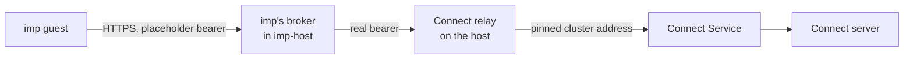

# 1Password Connect

A granted imp reads items from the owner's 1Password vault `imp` through a 1Password Connect server
in the cluster, and the imp never holds the Connect token. imp's credential broker holds the token
and adds it to each request, so the guest sees only a placeholder. Connect has no public route, and
imp-host cannot reach the cluster directly, so each request takes a fixed path through a relay on
the host. [Secrets](../secrets.md) covers how the token reaches impd, and
[firewalls](../network/firewalls.md) covers the tables the path crosses.

## The path

1. A guest with a grant for Connect sends an HTTPS request to `op-connect.imp.internal`, a name that
   exists only inside imp's broker.
2. The broker swaps the placeholder bearer for the real Connect token, which impd keeps as one of
   its secrets, and forwards the request to the relay's address on Docker's bridge.
3. The relay, a socket-activated proxy on the host, opens a connection to Connect's Service at its
   cluster address.
4. The Service sends the request to the Connect server, which answers from its synced copy of the
   vault.

The relay exists because imp's forward table drops imp-host's traffic to the cluster's ranges, and
the drop holds even after kube-proxy rewrites a destination, so the container can reach neither the
Service, nor a pod, nor a NodePort. The host is not under that rule, so the host dials the Service
for it. systemd holds the relay's socket and starts the proxy on the first connection, so the socket
can bind Docker's bridge address before Docker has created the bridge.

The relay dials the Service by its cluster address, so the Service pins that address, and Pulumi
ignores any later change to it. Recreating the Service at a new address would silently break the
relay until the host's configuration changed to match. The relay also assumes imp-host sits on
Docker's default bridge, so the host's configuration refuses to build with imp's IPv6 mode on, which
moves imp-host to a bridge of its own.

## What limits a read

- **The token is read-only.** The Connect token reads the `imp` vault only, so Connect itself
  refuses a write and any other vault.
- **The grant is per imp.** Only an imp that impd granted the Connect secret gets the broker's
  injection, so an ungranted imp reaches the name and gets no token.
- **The relay's port is local.** The host's narrowing table admits the relay's port from Docker's
  subnet only, on Docker's bridge. Every container on that bridge can reach it, imp's Docker proxy
  and image builds included, and each still needs the bearer.
- **The cluster is open.** No NetworkPolicy covers the Service, so any pod in the cluster can reach
  Connect, and only the bearer token stops it.

## Credentials

Connect has two secrets. The server's credentials file lets it sync the vault, and Pulumi turns it
into the server's Secret from 1Password. The access token, which the broker presents, lives only in
impd: neither the repo nor Pulumi holds it. A token rotation is therefore an impd change and no
Pulumi run ([the Connect runbook](../../runbooks/onepassword-connect.md)).
