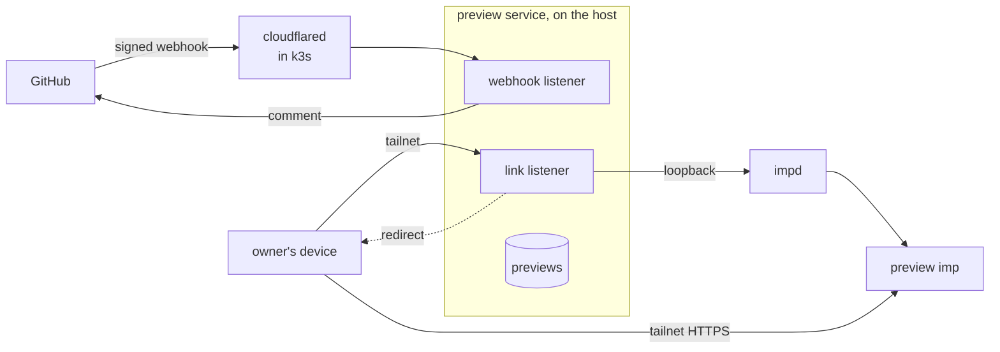
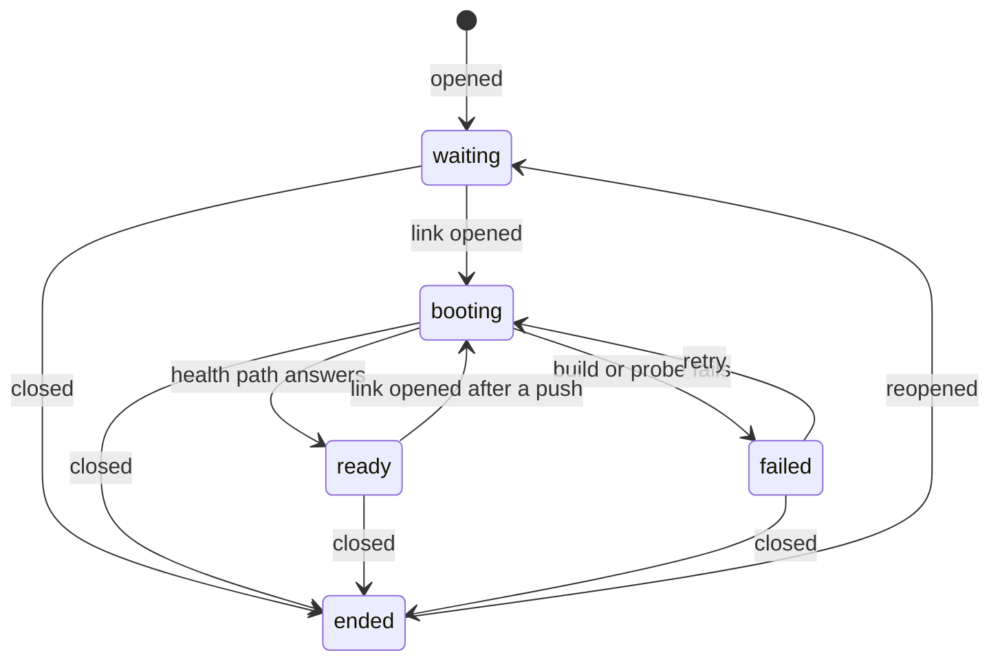

# Previews

A preview is one pull request's code running in its own imp, so the owner and the agents can check a
change live without touching production. The preview service, a NixOS service on the host, posts one
comment on each pull request of an opted-in repository with a tailnet link. Opening the link boots
the pull request's head commit from its `preview/` folder, or wakes the imp that already runs it,
and closing the pull request destroys the imp. The service knows nothing about any project: a
repository opts in with a Compose file, a seed step that loads invented data, and a health path.
[imp on the host](../host/imp.md) covers impd, which runs each preview's imp, and
[the preview runbook](../../runbooks/preview.md) gives the steps to set the service up, opt a
repository in and check it live.

## Two listeners

The service listens twice on the host's tailnet address, so the public route reaches only the part
that checks signatures. The webhook listener takes GitHub's `pull_request` deliveries through a
tunnel hostname, the one public endpoint, and the host admits its port only from pod addresses,
because cloudflared dials it from its pod. The listener checks each delivery's HMAC signature
against the webhook's secret before it parses the body, so an unsigned or wrongly signed call gets a
401 and reaches no other code. The link listener serves the links on the tailnet only, and the
tailnet policy lets only member devices reach it.

A signed delivery changes a preview only for a repository the service lists, by name or by its
owner, and only when the pull request's head branch lives in that repository. A pull request from a
fork never gets a preview, because its code would run in an imp that holds the broker's GitHub
credential.

## A pull request's preview

The service keeps one record per pull request in a SQLite file in its state directory: the imp's
name, the head commit, the commit the imp last built, and the preview's phase. impd stays the source
of truth for whether an imp runs or sleeps, so the record never says so.

- **opened, reopened or synchronize.** The service reads `preview/compose.yaml` at the head commit.
  A commit without the file has not opted in, and the service does nothing. Otherwise it records the
  head commit and posts the pull request's comment, or edits it in place: a marker in the comment
  body and the token's own login tell the service's comment from every other. A synchronize never
  brings an ended preview back; only an open or a reopen does.
- **The link opens.** A ready preview whose built commit is the head wakes if it sleeps, and the
  link redirects to the imp's own HTTPS name, which impd's wake proxy serves on the tailnet. A wake
  that restores the imp's memory brings its containers back as they were, but a cold boot starts
  dockerd alone, so a woken preview must answer its health path within a short grace before the
  redirect, and otherwise boots again. Any other preview starts a boot and answers with a page that
  reloads until the boot settles. A failed preview shows the tail of its build output and a retry
  link instead of booting again on every reload.
- **closed, merged or not.** The service marks the preview ended, destroys its imp, and edits the
  comment to say the preview ended. The link then answers that the preview is gone. A close for a
  pull request the service has no record of still records it as ended, and posts no comment. A
  redelivered close removes the imp and posts the comment again, so a failed first attempt heals on
  GitHub's next delivery.

The service handles one delivery at a time, in the order they arrive, so an older push that still
waits on GitHub never stores its head after a newer one.

A phase change names the phases it may leave, and the store makes it only from one of them. Two
opens at once therefore start one boot, and a boot that settles after its pull request closed leaves
the preview ended.

## A boot

A boot runs after the link answers, so a slow build never holds a request open.

1. The service reads the head commit's Compose file again, since the head may have moved, and takes
   the app's port and health path from its `x-preview` block, a top-level key that Compose ignores.
2. A new imp gets that port as impd's HTTP port and no backup. An imp from an earlier build keeps
   its disk and takes the new commit's port. Either way, the boot adds the grant of the broker's
   GitHub secret when the imp lacks it, so an imp whose grant failed gets it on the next boot.
3. A guest command installs Docker Compose's pinned release binary, checked against its sha256, when
   the image lacks the Compose plugin, as imp's base image does. It then fetches the head commit
   into a checkout in the imp, takes down the stack of the previous build with its volumes, and runs
   `docker compose up` from `preview/`, waiting for each service. The fetch runs only when impd
   confirms the broker reaches it, so a private repository clones with the broker's credential and
   no key sits in the guest.
4. The service probes the health path from inside the guest until it answers or the boot times out.

A rebuild discards the old volumes, so every build seeds its data afresh, and the seed never needs
to know whether it ran before.

## Slots and sleep

The service runs at most a set number of previews at once, one by default, because each preview's
imp holds memory from impd's budget while it runs. Before a preview boots or wakes, the service
lists the running preview imps and puts the least recently active to sleep until the opening one
fits. A sleeping imp keeps its memory on disk, so its next open resumes it where it stopped. A sweep
on a timer puts every preview to sleep that nobody used for the idle timeout, and impd counts each
request through its wake proxy as use.

The slot rule runs under one lock, so two opens at once never both find a free slot. A boot holds
the lock until it settles, because its build's guest commands would wake an imp that another open
put to sleep while it ran. Boots therefore run one at a time, and a ready preview opened while
another boots gets a page that reloads until the boot settles, rather than a request held open for
the length of a build.

impd confines the service's token to the imps whose names start with the preview prefix, so the slot
rule and the sweep never sleep another imp, and a mistake in the service cannot reach the agents'
imps.

## State

The previews file holds no secret and nothing a preview needs to run, and it has no backup. Losing
it loses the record of each pull request, so a link answers that it knows no preview until the pull
request's next push records it again. A closed pull request's imp still goes, because the imp's name
derives from the repository and the pull request number, not from the record.
