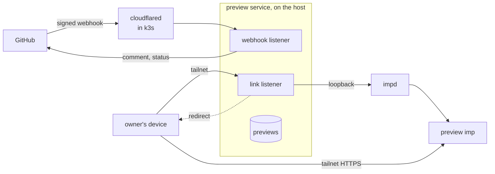
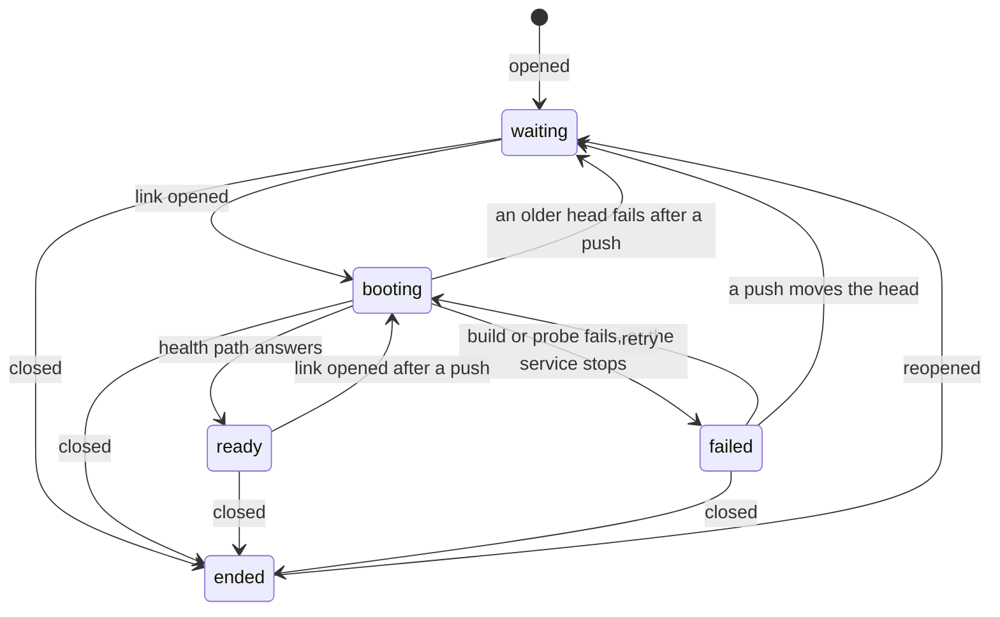

# Previews

A preview is one pull request's code running in its own imp, so the owner and the agents can check a
change live without touching production. The preview service, a NixOS service on the host, posts one
comment on each pull request of an opted-in repository with a tailnet link. Opening the link boots
the pull request's head commit from its `preview/` folder, or wakes the imp that already runs it,
and closing the pull request destroys the imp. The service knows nothing about any project: a
repository opts in with a Compose file, a seed step that loads invented data, and a health path. A
pull request that changes the Agent SDK's pin in a repository the service lists for it also gets a
commit status from a run of that repository's SDK contract suite, in an imp of its own.
[imp on the host](../host/imp.md) covers impd, which runs each preview's imp, and
[the preview runbook](../../runbooks/preview.md) gives the steps to set the service up, opt a
repository in and check it live.

## Two listeners

The service listens twice on the host's tailnet address, so the public route reaches only the part
that checks signatures. The webhook listener takes the preview GitHub App's `pull_request`
deliveries through a tunnel hostname, the one public endpoint, and the host admits its port only
from pod addresses, because cloudflared dials it from its pod. The listener checks each delivery's
HMAC signature against the App's webhook secret before it parses the body, so an unsigned or wrongly
signed call gets a 401 and reaches no other code. The link listener serves the links on the tailnet
only, and the tailnet policy lets only member devices reach it.

A signed delivery changes a preview only for a repository the service lists, by name or by its
owner, and only when the pull request's head branch lives in that repository. A pull request from a
fork never gets a preview, because its code would run in an imp that holds the broker's GitHub
credential. That credential is impd's `gh` secret, a fine-grained token that reads the contents of
the listed repositories and nothing else, so a preview's code can clone its own repository but can
neither push to it nor reach a repository the service does not list.

## GitHub access

The service reaches GitHub as the preview GitHub App, and an install of the App on a repository is
that repository's opt-in: GitHub sends the App's deliveries only for the repositories it is
installed on, and the comments post as the App's bot. The service holds the App's private key and no
GitHub token. For each call, such as one comment update, it signs a short-lived JWT with the key,
looks up the App's installation on the repository, and mints an installation token scoped to that
one repository, which it drops when the call ends. A leaked installation token reaches one
repository, and it expires at the end of the lifetime that GitHub fixes for it. The App is private
to the owner's account, so no other account can install it and send the service deliveries.

## A pull request's preview

The service keeps one record per pull request in a SQLite file in its state directory: the imp's
name, the head commit, the commit the imp last built, and the preview's phase. impd stays the source
of truth for whether an imp runs or sleeps, so the record never says so.

The store holds these moves in one transition table. One store function writes every phase change,
and it refuses a move the table lacks, so the webhook, the link, a settling boot and the startup
sweep of interrupted boots all follow the same rule.

- **opened, reopened or synchronize.** The service reads `preview/compose.yaml` at the head commit.
  A commit without the file has not opted in, and the service does nothing. Otherwise it records the
  head commit and posts the pull request's comment, or edits it in place: a marker in the comment
  body and the App's bot login tell the service's comment from every other. A synchronize never
  brings an ended preview back; only an open or a reopen does.
- **The link opens.** A ready preview whose built commit is the head wakes if it sleeps, and the
  link redirects to the imp's own HTTPS name, which impd's wake proxy serves on the tailnet. A wake
  that restores the imp's memory brings its containers back as they were, but a cold boot starts
  dockerd alone, so a woken preview must answer its health path within a short grace before the
  redirect, and otherwise boots again. Any other preview starts a boot and answers with a page that
  reloads until the boot settles. A failed preview shows the tail of its build output and a retry
  link instead of booting again on every reload.
- **closed, merged or not.** The service marks the preview ended, destroys its imp, and edits the
  comment to say the preview ended. The link then answers that the preview is gone. A close for a
  pull request the service has no record of still records it as ended, and posts no comment. A
  redelivered close removes the imp and posts the comment again, so a failed first attempt heals on
  GitHub's next delivery.

The service handles one delivery at a time, in the order they arrive, so an older push that still
waits on GitHub never stores its head after a newer one.

A phase change names the phases it may leave, and the store makes it only from one of them. Two
opens at once therefore start one boot, and a boot that settles after its pull request closed leaves
the preview ended. A boot's failure belongs to the head it built, so when a push moved the head
during the boot, the preview waits for its next open instead of failing. The pages that reload while
a boot runs load the link without its query, so one click on the retry link starts one boot.

## A boot

A boot runs after the link answers, so a slow build never holds a request open.

Every preview imp boots from one impd image, which the service names apart from impd's default image
so that an operator who points the default elsewhere leaves previews alone. A oneshot unit on the
host adds that image from imp's base image, pinned by digest, whenever a switch changes the pin or
imp-host restarts, and the service starts after it. A switch therefore never leaves the service
booting from an image impd lacks. The unit pins the image's name in impd too, so impd's image
eviction keeps the image while no preview imp runs. The release check moves that pin with the agent
image's, so the previews and the agents run one release of imp's base image.

1. The service reads the head commit's Compose file again, since the head may have moved, and takes
   the app's port and health path from its `x-preview` block, a top-level key that Compose ignores.
2. A new imp gets that port as impd's HTTP port and no backup. An imp from an earlier build keeps
   its disk and takes the new commit's port. Either way, the boot adds the grants of the broker's
   GitHub secret and model secret when the imp lacks them, so an imp whose grant failed gets it on
   the next boot.
3. A guest command installs Docker Compose's pinned release binary, checked against its sha256, when
   the image lacks the Compose plugin, as imp's base image does. It then fetches the head commit
   into a checkout in the imp, takes down the stack of the previous build with its volumes, and runs
   `docker compose up` from `preview/`, waiting for each service. The fetch runs only when impd
   confirms the broker reaches it, so a private repository clones with the broker's credential and
   no key sits in the guest. When the commit has `preview/compose.broker.yaml`, the guest command
   adds it to `docker compose up` and passes it the broker's proxy and CA bundle, which impd sets on
   the command. The stack's model calls then go out through the broker, which adds the model
   secret's credential.
4. The service probes the health path through the imp's own HTTPS name until it answers or the boot
   times out. The probe takes the route of impd's proxy, which reaches the app on the imp's own
   address and never on the guest's loopback, so an app that listens on the loopback alone fails its
   boot instead of passing the probe and answering 502 after the redirect.

A rebuild discards the old volumes, so every build seeds its data afresh, and the seed never needs
to know whether it ran before.

## The spend cap

With the spend cap on, each preview's model calls pass through a counting proxy of its own, so a
runaway preview stops at a small limit instead of using up the shared model credential. The cap sits
outside the preview's imp, because the code under test runs its tools with no security boundary and
could change anything inside the imp. The counting proxy is nixie's own program, a release binary
that the host pins, and nixie's architecture docs own how it prices and counts a reply.

The broker sends every preview's model calls to one listener of the service on the docker bridge,
because an impd secret has one upstream for all the imps it is granted to. The first segment of each
call's path names the imp, and the model grant's path filter admits only the imp's own segment, so
one preview can neither spend from another's count nor skip its own. The repository's preview stack
puts that segment on its model address when the boot passes it the route. The listener starts the
imp's proxy on loopback on the first call, waits for the port the proxy names, and forwards the call
unchanged. A proxy that fails to start gets the call a 503, so a preview without its counter makes
no model call.

Each proxy counts in a file of its own in the service's state, and the count lasts for the pull
request's life. A proxy idle for the sleep time stops and keeps its count, and the next call starts
it again from that count. Closing the pull request stops the proxy and removes its count with the
imp. The proxy refuses a model other than the one the host config names, at the prices it names.

## Slots and sleep

The service runs at most a set number of previews at once, one by default, because each preview's
imp holds memory from impd's budget while it runs. Before a preview boots or wakes, the service
lists the running preview imps and puts the least recently active to sleep until the opening one
fits. A sleeping imp keeps its memory on disk, so its next open resumes it where it stopped. A sweep
on a timer puts every preview to sleep that nobody used for the idle timeout, and impd counts each
request through its wake proxy as use.

The slot rule runs under one lock, so two opens at once never both find a free slot. A boot holds
the lock until it settles, because its build's guest commands would wake an imp that another open
put to sleep while it ran. Boots therefore run one at a time, and a ready preview opened while
another boots gets a page that reloads until the boot settles, rather than a request held open for
the length of a build.

impd confines the service's token to the imps whose names start with the preview prefix, so the slot
rule and the sweep never sleep another imp, and a mistake in the service cannot reach the agents'
imps.

## The SDK contract run

The SDK contract suite checks the behaviours a repository relies on against the model, so it needs
the model credential, and the run keeps that credential out of GitHub. The suite runs in an imp that
impd grants the model secret, and the guest holds only a placeholder where the CLI reads its
credential. The broker replaces the placeholder's header with the credential on each request to the
model's API. A pull request from a fork never runs the suite, for the reason it gets no preview.

On an opened, reopened or synchronize delivery from a repository the contract settings list, the
service reads the pull request's changed files. A changed line of a `package.json` or a `bun.lock`
that holds the SDK's package name claims a run for the head commit. GitHub leaves out the diff of a
file too large to show, and such a manifest counts as a change, because a needless run costs less
than a missed one. The previews file holds one record per repository and head commit, so a commit
runs the suite once however many deliveries name it, and each push to a new head runs it again.

1. Under the slot lock, the service counts the running imps. A run never puts a preview to sleep,
   because the owner may be using it, so with every slot taken the run waits. Its `sdk-contract`
   status turns pending with that reason, and the sweep's timer tries the run again on each pass.
2. With a slot free, the service starts a new imp from the preview image, grants it the model secret
   and the GitHub secret, and sets the status to pending.
3. A guest command installs Bun's pinned build, checked against its sha256, since imp's base image
   lacks Bun. It fetches the head commit, installs the dependencies from the lockfile, and runs the
   suite. impd starts the command only when the broker reaches the guest.
4. The service records the result, removes the imp, and then sets the status to success or failure
   with the suite's pass and fail counts. A failure to start the imp sets an error status instead.
   The record keeps the result until impd removes the imp and GitHub takes the status, and the
   sweep's timer retries either step that fails. A leftover imp therefore never holds a slot for
   good, and a status never stays pending after its run ends.

The guest's `timeout` bounds the whole run, and a deadline on the host backs it for a guest that
never reports an exit. Either way the status reports failure at the time limit, and the imp goes. A
run's imp holds a slot like a preview's, but neither the slot rule nor the idle sweep puts it to
sleep, because its suite would stop halfway, so a preview that opens meanwhile runs beside it. A run
that a stopped service left behind starts over at the next start's first retry, on a fresh imp. A
service started without contract settings runs no suite, so the retry ends each run it still holds
with an error status and removes its imp.

The store holds a run's moves in a transition table of their own. A run waits for a slot, runs, and
settles, and a stopped service's next start queues a running run again. A settled run passes or
fails and never moves after that. One store function writes every change of a run's phase and
refuses a move the table lacks, so a try, the retry and the startup sweep all follow the same rule.

## State

The previews file holds no secret and nothing a preview needs to run, and it has no backup. Losing
it loses the record of each pull request, so a link answers that it knows no preview until the pull
request's next push records it again. A closed pull request's imp still goes, because the imp's name
derives from the repository and the pull request number, not from the record. Losing the file also
loses the record of each contract run, so the next delivery for a head commit that ran before runs
its suite again.
